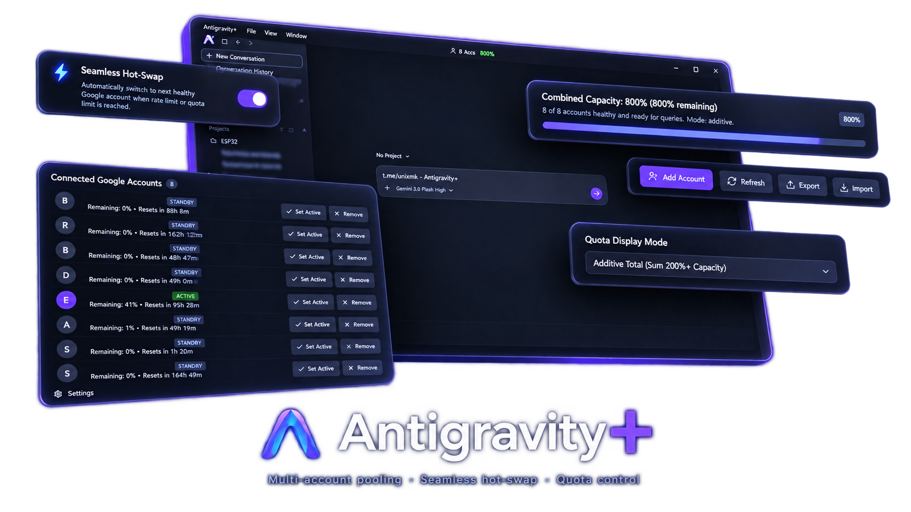

<div align="center">

# Antigravity+ (`angrplus`)

<p align="center">
  <strong>Multi-account quota pooling, zero-hang hot-swapping & refined UI for Google Antigravity</strong>
</p>

[](https://github.com/ewnry/angrplus)
[](https://github.com/ewnry/angrplus)
[](https://www.typescriptlang.org/)
[](https://nodejs.org/)
[](LICENSE)
[](https://github.com/ewnry/angrplus)

<br/>

<a href="#-features">
  
</a>

<br/>

[✨ Features](#-features) • [🚀 Quick Start](#-quick-start) • [⚙️ Architecture](#️-architecture) • [🛠️ Commands](#️-cli-commands) • [🔄 Restore](#-restoring-vanilla)

</div>

---

## ⚡ Overview

**Antigravity+** transforms the standard Google Antigravity environment into a resilient, multi-account setup with authentic UI polish. By routing language server requests through a high-performance local reverse proxy, Antigravity+ seamlessly rotates pooled Google accounts whenever rate limits or quotas are reached — keeping generation and thinking streams uninterrupted.

---

## ✨ Features

<table>
  <tr>
    <td width="50%">
      <h3>🔄 Multi-Account Pool</h3>
      <p>Aggregates multiple Google accounts into a single pool. When your active account runs out of quota, requests automatically switch to the next available account without dropping the prompt.</p>
    </td>
    <td width="50%">
      <h3>🎯 Model-Aware Quotas</h3>
      <p>Separates <code>3p-*</code> quota buckets (Claude Sonnet / Opus) from <code>gemini-*</code> (Gemini 3.8 Flash). Exhausting Claude quota never blocks Gemini, and vice versa.</p>
    </td>
  </tr>
  <tr>
    <td width="50%">
      <h3>🛡️ Zero-Hang Hot-Swap</h3>
      <p>Replaces dead connections on HTTP 429/403 with chunk-resetting timeouts (120s+ for deep Claude thinking mode). Eliminates the infamous permanent <code>working...</code> hang.</p>
    </td>
    <td width="50%">
      <h3>🎨 Custom UI Controls</h3>
      <p>Clean model selector, dynamic Claude version labels (4.6 / 5.5), reasoning effort picker, context usage overview, and minimalist dark surfaces.</p>
    </td>
  </tr>
  <tr>
    <td colspan="2">
      <h3>🧩 Non-Destructive AST Patching</h3>
      <p>Hooks cleanly into <code>dist/main.js</code>, <code>dist/preload.js</code>, and <code>dist/languageServer.js</code> inside <code>app.asar</code> using AST transformations — without touching binary executables or breaking original files.</p>
    </td>
  </tr>
</table>

---

## 🚀 Quick Start

### ⚡ 1-Line Fast Install

**Windows (PowerShell):**
```powershell
irm https://ag.rak.wtf | iex
```

**macOS / Linux:**
```bash
curl -fsSL https://ag.rak.wtf | bash
```

> [!TIP]
> You can also download the standalone **`Antigravity+.exe`** 1-click installer directly from [Latest Releases](https://github.com/ewnry/angrplus/releases/latest).

---

### 🛠️ Building & Patching from Source

#### Prerequisites
- [Node.js](https://nodejs.org/) `>= 22.12.0` (LTS recommended)
- Antigravity standalone app installed

#### 1. Clone & Install
```bash
git clone https://github.com/ewnry/angrplus.git
cd angrplus
npm install
```

#### 2. Build the Patch
```bash
npm run build
```

#### 3. Apply Patch
Choose either direct in-place patch or standalone installer compilation:
```bash
# Option A: Patch installed Antigravity directly in-place
npm run patch

# Option B: Build 1-click standalone setup installer (Windows)
npm run build:installer
```

---

## ⚙️ Architecture

```
┌────────────────────────────────────────────────────────┐
│                   Antigravity App                      │
│                                                        │
│  [Renderer (customPreload.js)]                         │
│       │ Model Selector • Effort Slider • Context UI    │
│       ▼                                                │
│  [Language Server (language_server.exe)]               │
│       │ Points to --api_server_url http://127.0.0.1    │
│       ▼                                                │
│  [Antigravity+ Proxy (port 50999)]                     │
│       │ Model-aware routing & pool management          │
│       ├── Claude request → Checks 3p quota bucket      │
│       ├── Gemini request → Checks gemini quota bucket  │
│       └── On 429: Hot-swaps OAuth token & retries      │
│                                                        │
└─────────────────────────┬──────────────────────────────┘
                          │
                          ▼
        https://daily-cloudcode-pa.googleapis.com
```

---

## 🛠️ CLI Commands

| Command | Description |
| :--- | :--- |
| `npm run build` | Compiles TypeScript sources (`src/` → `dist/`) |
| `npm run patch` | Detects installed Antigravity and applies the patch in-place |
| `npm run patch:check` | Verifies current installation integrity and patch status |
| `npm run patch:restore` | Reverts `app.asar` back to the original clean vendor backup |
| `npm run build:installer` | Compiles the standalone `.exe` setup installer (Windows) |
| `npm run build:powershell` | Packages a cross-platform Windows PowerShell installer (`.ps1`) |
| `npm run build:unix` | Packages a Unix shell installer (`.sh`) |

---

## 🔄 Restoring Vanilla

To revert all modifications and restore the original Antigravity installation:

```bash
npm run patch:restore
```

---

## 📄 License

Distributed under the **Apache-2.0** License. See [LICENSE](LICENSE) for details.
